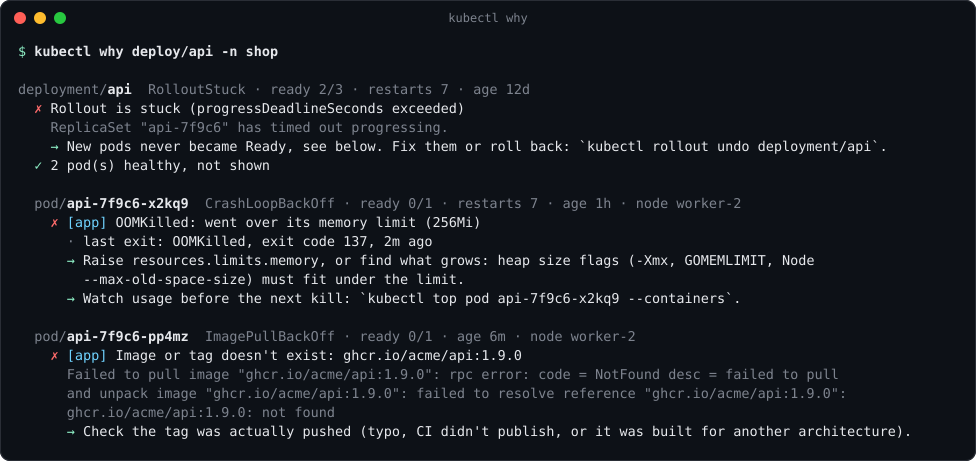

# kubectl-why

[](https://github.com/Sakuratix/kubectl-why/actions/workflows/ci.yml)
[](https://github.com/Sakuratix/kubectl-why/releases)
[](https://goreportcard.com/report/github.com/Sakuratix/kubectl-why)


A kubectl plugin that tells you **why** a pod or deployment is unhealthy, in plain words, with the evidence and what to try next.

`kubectl describe` gives you everything and explains nothing. `kubectl why` reads the same status, container states, probes and events and does the part you usually do in your head at 3 a.m.



## Install

With [krew](https://krew.sigs.k8s.io/) (every release ships a `why.yaml` manifest):

```sh
kubectl krew install --manifest-url=https://github.com/Sakuratix/kubectl-why/releases/latest/download/why.yaml
```

Or grab a binary from [Releases](https://github.com/Sakuratix/kubectl-why/releases) (Linux, macOS, Windows; amd64 and arm64), put it in your `PATH`, and kubectl picks it up as `kubectl why`:

```sh
curl -sL https://github.com/Sakuratix/kubectl-why/releases/latest/download/kubectl-why_linux_amd64.tar.gz | tar xz kubectl-why
sudo install kubectl-why /usr/local/bin/
```

Or from source: `go install github.com/Sakuratix/kubectl-why/cmd/kubectl-why@latest`

## Usage

```sh
kubectl why pod/api-7f9c6-x2kq9      # one pod
kubectl why deploy/api -n prod       # a deployment: rollout state + its broken pods
kubectl why -n prod                  # every unhealthy pod in the namespace
kubectl why -A                       # ... in every namespace
kubectl why deploy/api -o json       # for scripts and bots
kubectl why deploy/api -o markdown   # for tickets and PR comments
```

Exit code is `0` when everything is healthy, `1` when it found problems, `2` on errors, so it also works as a post-deploy check in CI:

```sh
helm upgrade --install api ./chart --wait --timeout 3m || kubectl why deploy/api -n prod
```

### Reports for tickets and pull requests

`-o markdown` turns the same diagnosis into GitHub-flavoured Markdown: severity icons, evidence as a list, and the hints as a task list someone can tick off. Paste it into the incident ticket, or let CI post it when a deploy fails:

```yaml
- name: explain a failed rollout
  if: failure()
  run: kubectl why deploy/api -n prod -o markdown >> "$GITHUB_STEP_SUMMARY"
```

Event and termination messages are escaped, so a crashing app can't inject HTML into your tracker. This repo's own CI does exactly this against a kind cluster full of broken pods; open any [ci run](https://github.com/Sakuratix/kubectl-why/actions/workflows/ci.yml) to see the result.

## What it recognises

| Situation | What you get |
|---|---|
| `OOMKilled` | the memory limit it hit, and how to see real usage |
| `CrashLoopBackOff` | exit code in words (1, 126, 127, 137, 139, 143...), the termination message, the `logs --previous` command |
| Killed by liveness probe | the probe spec, the last failure, startupProbe advice |
| Readiness probe failing | why: connection refused / 5xx / 404 / timeout, each with its own fix |
| `ImagePullBackOff` | tag doesn't exist vs. private registry (imagePullSecrets) vs. registry unreachable vs. Docker Hub rate limit |
| `CreateContainerConfigError` | the exact Secret / ConfigMap / key that is missing |
| `Pending` / unschedulable | each scheduler reason split out: insufficient CPU/memory with your requests, taints, affinity, unbound PVC, max pods, cordoned nodes |
| Volume won't mount | Multi-Attach during rollouts, missing objects, CSI timeouts |
| Init container failing or hanging | which one, its exit and message |
| Sandbox creation failed | points at the CNI on that node |
| Stuck `Terminating` | finalizers that block it, node health, the force-delete last resort |
| `Evicted` | the kubelet's message and how to avoid being picked next |
| Deployment | `ProgressDeadlineExceeded`, ResourceQuota blocking new pods, ready vs. desired, with every unhealthy pod explained below |

Warnings it can't explain are still listed under *other recent warnings*, so nothing is hidden.

## How it works

- **No client-go, zero dependencies.** The plugin runs `kubectl get ... -o json` and decodes the few fields it needs. That keeps the binary small and means it uses your kubeconfig, context, exec auth plugins and proxy exactly like kubectl does. `--context` and `--kubeconfig` are passed through.
- **Rules are plain Go** in [`internal/diagnose`](internal/diagnose): each one looks at container state + events and produces a finding with severity, evidence and hints. Adding a rule is a function and a fixture.
- **Tested on recorded API output.** [`testdata/`](testdata) has real-shaped pod, deployment and event JSON for every case above, and golden files with the expected output (`make golden` after an intended change).
- **Tested on a real cluster.** CI spins up [kind](https://kind.sigs.k8s.io/), deploys [pods broken on purpose](test/e2e/manifests/broken.yaml) (OOM, crash, bad tag, missing secret, refused readiness, unschedulable, stuck rollout) and checks that each one is explained correctly.
- Releases are built by GoReleaser for 6 platforms on every `v*` tag.

## Development

```sh
make test     # unit + golden tests
make lint     # gofmt + go vet
make e2e      # needs a throwaway cluster: kind create cluster
make demo     # regenerate docs/demo.svg
```

## License

MIT
